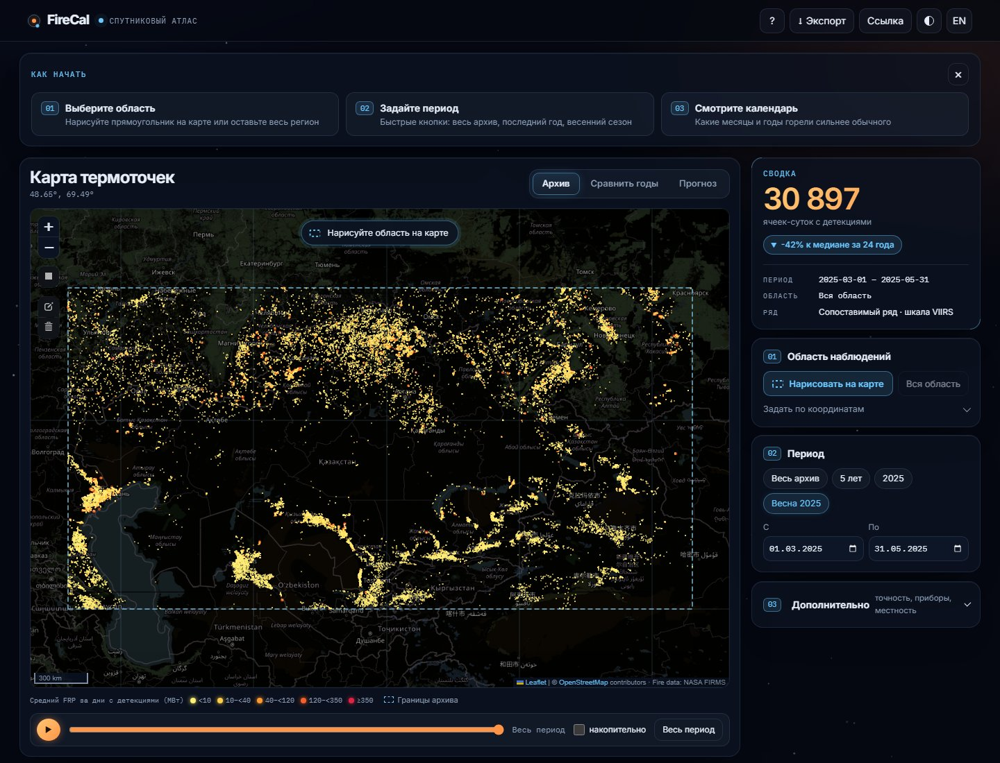
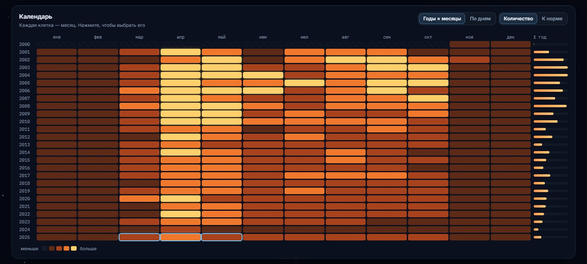

# FireCal

**A harmonized MODIS + VIIRS burning activity calendar and hotspot outlook.** Team Yin Yang · NASA Space Apps Challenge 2026 · [Harmonization of MODIS and VIIRS Hot Spots](https://www.spaceappschallenge.org/2026/challenges/harmonization-of-modis-and-viirs-hot-spots/)



FireCal turns 25 years of NASA FIRMS hotspots (Terra/Aqua MODIS since November 2000, Suomi NPP VIIRS since January 2012) into one consistent series for Kazakhstan and neighbouring territory. Pick an area on the map and a period, and FireCal shows:

- a **burning activity calendar** of years × months, as counts on the VIIRS scale or as the ratio to the usual level for that month;
- how the selected period compares with the **historical median** of the same dates in other years, plus anomalous days and months;
- a **hotspot outlook**: the probability of a VIIRS hotspot in every 0.25° cell for the next day and the next 7 days, backtested on 2023–2025;
- **year-to-year comparison** on a swipe map, CSV and PNG export, and a shareable link to the current view.



## Run locally

Run these commands in the directory containing this README with Python 3.12 or 3.13 installed.

```powershell
python -m venv .venv
.\.venv\Scripts\python.exe -m pip install -r requirements.txt
.\.venv\Scripts\python.exe -m uvicorn backend.main:app
```

Open [FireCal](http://127.0.0.1:8000/). On Windows, after creating the virtual environment, you can instead double-click `start_local.bat`, or `start_public.bat` to share a temporary public link with a QR code through a free SSH tunnel. On the first start the server builds `data/firecal.duckdb` from the compressed copy in `data/db/` (about 20 seconds). No FIRMS API key is needed. The background map uses OpenStreetMap tiles over the internet. A `Dockerfile` is included for container hosting. On small hosts, set `FIRECAL_DUCKDB_MEMORY=256MB` to cap memory use.

## Hotspot outlook

In the atlas, open **Hotspot outlook** and pick an issue date in 2023–2025. The map shows, for every 0.25° cell of the archive footprint (64 × 188 = 12,032 cells), the probability of at least one Suomi NPP VIIRS hotspot on the next day or during the next 7 days. **Ratio to normal** divides that probability by the seasonal climatology, so above-normal and below-normal areas stand out. White dots are the hotspots that VIIRS actually recorded in the forecast window. Dashed outlines mark 4° × 4° blocks that never entered training. Draw an area to compare the expected number of burning cells with the seasonal normal and with what was observed. Click a cell for its numbers.

```powershell
.\.venv\Scripts\python.exe -m pip install -r requirements-forecast.txt
.\.venv\Scripts\python.exe pipeline/forecast_weather.py     # NASA POWER download, resumable (~1 h)
.\.venv\Scripts\python.exe pipeline/forecast_features.py    # ~2 min, writes a 3.7 GB feature cache
.\.venv\Scripts\python.exe pipeline/train_forecast.py       # ~25 min on a 6-core CPU
```

The API serves `data/forecast/predictions.npz` and `data/forecast/metrics.json` and needs neither PyTorch nor network access. The trained models are saved next to them (`cnn_full.pt`, `lgbm_*.txt`). `features.npy` and `.power-cache/` are build caches and are not needed to run the app.

**Inputs.** For an issue date `t` (end of UTC day `t`) each cell gets:

- *Fire history* from the archive: detections today and in the last 7/30 days in the cell and in 3×3, 5×5 and 9×9 neighbourhoods, days since the last detection, and the same week last year.
- *Harmonized seasonal climatology*: expected VIIRS-scale cell-days for the target week from 2001–2022. MODIS counts before February 2012 are converted with the calendar-month VIIRS/MODIS ratio. A VIIRS-only weekly occurrence frequency (2013–2022) is included as well. Training years are left out of their own climatology, and test years are never part of it.
- *Land cover*: share of the cell's historical detections on tree cover and cropland (ESA WorldCover 2021).
- *Fire weather* from [NASA POWER](https://power.larc.nasa.gov/) daily MERRA-2 (0.5° × 0.625°, no API key): the Canadian Fire Weather Index System (FFMC, DMC, DC, FWI) computed in `pipeline/fwi.py` from daily maximum temperature, humidity at that temperature, mean wind and precipitation, plus 7/30-day rain, days since rain and soil wetness.
- *Weather in the forecast window* (`t+1…t+7`): temperature, humidity, maximum wind, rain and FWI.

**Models and evaluation.** Training covers 2013–2021. 2022 is used for early stopping and to choose the mapped model. 2023–2025 is the test period and is never used for fitting or selection. 20% of the 4° × 4° blocks are excluded from training and scored separately. Days with a VIIRS instrument gap (MODIS detections but no VIIRS record anywhere, 39 days, for example 27 July – 10 August 2022) are excluded from scoring. Each model adds one source of information:

| Model (7-day outlook, test 2023–2025) | AP known cells | AP held-out blocks | AP forest cells | Hotspots in top 10% of cells | Brier skill vs climatology |
| --- | ---: | ---: | ---: | ---: | ---: |
| Seasonal climatology (harmonized) | 0.330 | 0.328 | 0.258 | 59% | 0 |
| + recent detections | 0.422 | 0.413 | 0.367 | 65% | 0.13 |
| LightGBM, fire history only | 0.465 | 0.431 | 0.375 | 68% | 0.17 |
| LightGBM, + observed fire weather | 0.469 | 0.436 | 0.382 | 68% | 0.17 |
| LightGBM, + forecast-window weather | 0.498 | 0.475 | 0.424 | 69% | 0.19 |
| **PyTorch CNN, + forecast-window weather** (mapped) | **0.504** | **0.482** | **0.434** | **70%** | **0.21** |

For the next-day outlook the same models score AP 0.130 → 0.256 → 0.305 → 0.308 → 0.334 → 0.337 on known cells, and the CNN places 82% of next-day hotspots in the 10% highest-risk cells. The base rates are 4.3% of cell-weeks and 1.0% of cell-days. The test contains 300,762 positive cell-weeks on known cells. The CNN probabilities are well calibrated: for example, cells predicted at 10–20% burned 13% of the time, and cells predicted above 50% burned 68% of the time. "Forest cells" are cells with at least 25% of their detections on tree cover. Full scores, calibration and feature importance are returned by `/api/fire-risk`.

**Limitations.**

- Weather for the forecast window comes from reanalysis, so the last two rows show skill with a *perfect* weather forecast. An operational system would feed a numerical weather forecast here and should expect lower skill. The "+ observed fire weather" row uses only data available on the issue date.
- Most of the skill comes from fire history and the harmonized climatology. Observed weather adds little on top of them. Weather in the forecast window, mainly rain and humidity, adds about 0.03 AP.
- The target is a satellite detection, not a fire. Clouds, overpass timing and sensor sensitivity shape it. Most hotspots in this region are agricultural and steppe burns.
- The archive ends on 31 December 2025, so the layer is a backtest. Live use needs recent FIRMS NRT detections and a weather forecast.

The fully convolutional network (`pipeline/forecast_net.py`) takes one issue day as a 34-channel 64 × 188 grid. A per-pixel branch is combined with dilated convolutions that see about 4° around each cell. The network predicts both horizons at once. It and the LightGBM models use identical inputs. The network was selected because it scored higher on 2022.

## Compare years

The swipe view shows observed detections for the same calendar month or the full year in each selected year. Both sides use one map camera, the same area and filters, and the same marker scale. If only one year has a February 29, the comparison omits that day. Date labels show the parts of a period outside the archive. Each side displays up to 50,000 cells ranked by total FRP. The analytical VIIRS scale is labeled separately.

Use arrow keys to rotate the globe, navigate the calendar and move the comparison divider when those controls have focus. The entry view uses a static Earth when WebGL is unavailable. Reduced-motion settings skip the camera animation. Map PNG exports use loaded basemap tiles that allow canvas export. When the basemap is unavailable the PNG still includes plotted data, outlines and the scale.

## Data and methods

- Marker colors and sizes use the mean of a cell's daily FRP values on days with detections in the selected period. Fixed color thresholds of 10, 40, 120 and 350 MW apply to the main map, comparison and PNG. Marker popups also report the sum of the daily FRP values.
- The land-cover filter uses ESA WorldCover 2021 v200. FireCal assigns each H3 cell the class at its center using the 64× overview of the 10 m tiles. Class 10 is tree cover and class 40 is cropland. All detections includes grasslands and other or unknown classes. The lookup is a 2021 snapshot applied across the archive, so it describes land cover and cannot identify ignition cause or historical land-use changes. The existing regional VIIRS calibration is also used on filtered series.
- The generated lookup is `data/fire_land_cover.parquet`. To rebuild it, install Rasterio and tifffile (used only by the build script), then run `python pipeline/classify_land_cover.py` with internet access.

- The regional snapshot covers 46°–93°E and 40°–56°N. It contains 2,340,080 H3 cell-days with detections from November 1, 2000 through December 31, 2025. Dates are UTC.
- The pipeline uses standard-processing Terra/Aqua MODIS and Suomi NPP VIIRS detections from [NASA FIRMS](https://firms.modaps.eosdis.nasa.gov/download/), using the [FIRMS Area API](https://firms.modaps.eosdis.nasa.gov/content/academy/data_api/firms_api_use.html). Detections are grouped by H3 resolution 7 and UTC day. Where source records contain a fire type, the pipeline keeps vegetation fires.
- The VIIRS scale uses VIIRS cell-day counts starting February 2012. It estimates earlier counts by multiplying MODIS counts by the median VIIRS-to-MODIS ratio for the calendar month. The calibration uses the whole study region and months with at least 30 MODIS cell-days and some VIIRS detections. Switching off the scale shows the observed union of both sensors.
- The headline comparison uses the median of fully covered date windows in other years. The dashed chart line shows their mean. Anomaly scores compare against the same calendar month in other years and require at least three other years of data.
- A cell-day may contain several satellite detections or represent part of a larger fire. Satellite coverage, clouds and sensor sensitivity affect detection. The snapshot represents an archive and provides no live alerts.

To rebuild the database from scratch, download raw detections with `pipeline/download.py`, then stop the server and run `pipeline/harmonize.py`, `pipeline/load_db.py` and `pipeline/calibrate.py` with the same Python interpreter. Run `pipeline/export_db.py` to refresh the compressed copy in `data/db/`. Raw and harmonized CSVs are not included in the repository because of their size. The optional `pipeline/download.py` script uses a local `FIRMS_KEY` environment variable or `.env` file.

## Third-party resources

- [ESA WorldCover 10 m 2021 v200](https://doi.org/10.5281/zenodo.7254221), [CC BY 4.0](https://creativecommons.org/licenses/by/4.0/). © ESA WorldCover project 2021 / Contains modified Copernicus Sentinel data (2021) processed by ESA WorldCover consortium. FireCal distributes a derived H3 lookup.

- [Leaflet 1.9.4](https://github.com/Leaflet/Leaflet/tree/v1.9.4), [BSD-2-Clause](frontend/vendor/leaflet/LICENSE), and [Leaflet.draw 1.0.4](https://github.com/Leaflet/Leaflet.draw), [MIT](frontend/vendor/leaflet-draw/LICENSE).
- [Inter](https://github.com/rsms/inter), [SIL Open Font License 1.1](frontend/vendor/inter/LICENSE).
- [IBM Plex Mono](https://github.com/IBM/plex), [SIL Open Font License 1.1](frontend/vendor/ibm-plex-mono/LICENSE).
- Earth imagery is the July 2004 [Blue Marble: Next Generation with Topography and Bathymetry](https://science.nasa.gov/earth/earth-observatory/blue-marble-next-generation/base-topography-bathymetry/) composite, credited to NASA Earth Observatory. [NASA Earth Science image reuse terms](https://science.nasa.gov/earth/faq/).
- [OpenStreetMap contributors](https://www.openstreetmap.org/copyright), map data under ODbL.
- [DuckDB](https://github.com/duckdb/duckdb) (MIT), [FastAPI](https://github.com/fastapi/fastapi) (MIT), [H3 Python bindings](https://github.com/uber/h3-py) (Apache-2.0), [NumPy](https://github.com/numpy/numpy) (BSD-3-Clause), [pandas](https://github.com/pandas-dev/pandas) (BSD-3-Clause), [Requests](https://github.com/psf/requests) (Apache-2.0), and [Uvicorn](https://github.com/encode/uvicorn) (BSD-3-Clause).
- The exploratory rocket-stage tab uses approximate reference areas based on [Semenkov et al. (2026)](https://doi.org/10.3390/fire9060234) and [Amic.ru](https://www.amic.ru/news/zhiteley-choyskogo-rayona-respubliki-altay-napugal-ocherednoy-zapusk-rakety-s-baykonura-176448). The analysis compares observed hotspot density and does not use launch dates.
